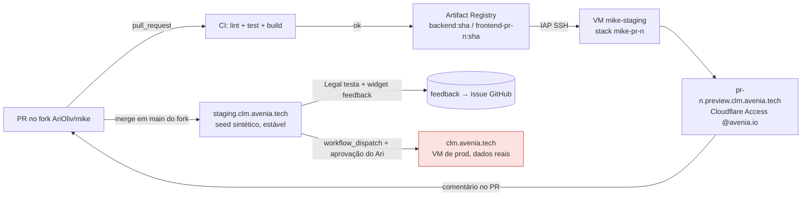
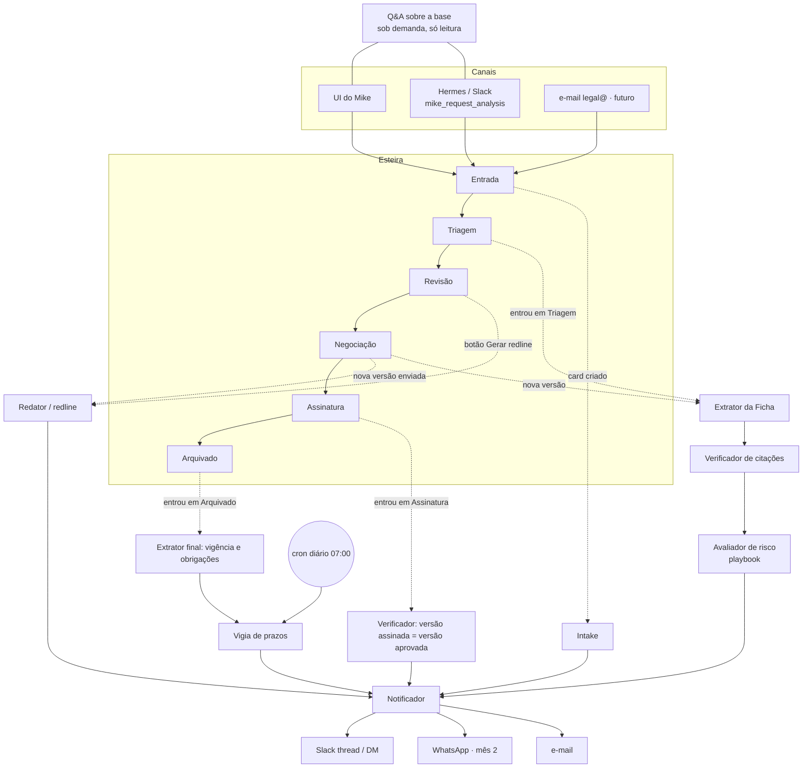
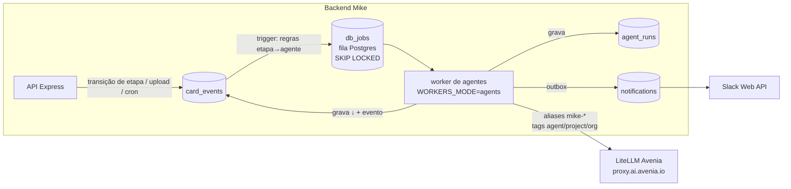
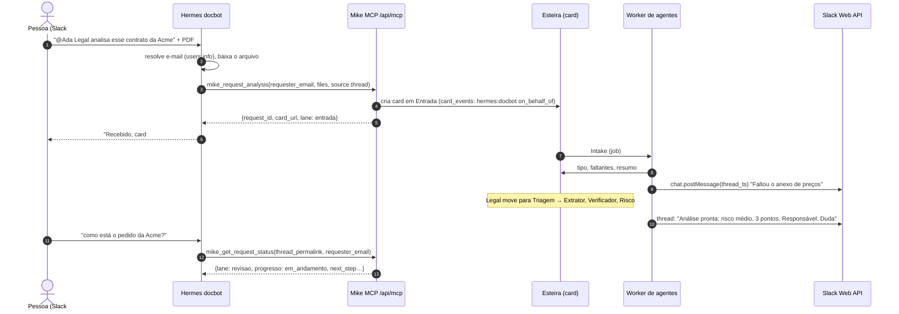

# 04 · Arquitetura da plataforma Mike

> Autor: Conduit (squad Mike) · 2026-10-20 · status: **proposta para decisão**
> Escopo: prévia sempre atualizada, arquitetura multi-agent, canal Hermes, vendorização.
> Rascunhos executáveis (NÃO executados) em [`infra/`](infra/README.md).

## TL;DR: decisões recomendadas

| # | Tema | Decisão | Por quê |
|---|---|---|---|
| D1 | Ambientes | **3 ambientes**: prévia por PR (`pr-<n>.preview.clm.avenia.tech`), **staging** estável (`staging.clm.avenia.tech`), **prod** (`clm.avenia.tech`, como está). Staging e prévias rodam numa **VM separada** da de produção. | Prod tem dado real e volumes que não podem ser tocados. Isolar por máquina é o mais barato e o mais seguro. |
| D2 | Acesso às prévias | **Cloudflare Tunnel + Cloudflare Access** (Google, só `@avenia.io`) em `*.preview` e `staging`. Prod segue com Caddy + GoTrue Google. | O Google OAuth não aceita redirect URI curinga, e o Access resolve o SSO de todas as prévias sem cadastrar nada por PR. |
| D3 | Dados fora de prod | **Só seed sintético** (contratos-modelo gerados + usuários demo). **Nenhuma cópia de prod** em staging ou prévia. | Contrato real tem dado pessoal e comercial (LGPD). Anonimizar PDF de forma confiável não cabe em semanas. |
| D4 | Feedback do Legal | **Widget "Dar feedback"** em staging e nas prévias → `POST /api/feedback` → tabela `feedback` + **issue no GitHub** (label `feedback`, comenta no PR da prévia). Notion opcional depois. | Fecha o ciclo com quem corrige (squad/agentes trabalham no GitHub) sem o Legal sair da tela. |
| D5 | Agentes | **Cada agente é um gatilho de etapa da esteira**, não um fluxo paralelo. Rodam **dentro do backend do Mike** como jobs numa **fila Postgres** (portar o `lib/dbq` do upstream). | Uma fonte da verdade (o card), estado e auditoria no mesmo banco, zero infra nova. |
| D6 | LLM | **Tudo pela LiteLLM da Avenia** (já configurada como `CUSTOM_OPENAI_BASE_URL`), com **aliases por função** (`mike-extract`, `mike-reason`, `mike-embed`) e tags `agent/project/org` para custo. | Custo, chave e troca de modelo num lugar só, sem deploy. |
| D7 | Claude Managed Agents / Agent SDK | **Não usar no núcleo agora.** Reavaliar só para o Redator (mês 2+), se o redline via playbook não bastar. | Os passos da esteira são extrações estruturadas e checagens curtas, não exploração aberta. Um runtime hospedado tira contrato do nosso perímetro e fura a contabilidade da LiteLLM. |
| D8 | Autoridade | **Agente escreve campo derivado (↓) e sugere; humano move etapa e mexe nos campos de gestão (↕).** | É o mesmo contrato de autoridade que já vale no espelho do Notion. |
| D9 | Auditoria | Tabela **append-only `card_events`** (quem: usuário/agente/sistema/Hermes; o quê; antes/depois; `run_id`) + **`agent_runs`** (modelo, versão do prompt, tokens, custo). | Responde "quem mudou o quê e por quê" e fornece o custo por contrato. |
| D10 | Hermes | O **Mike expõe um MCP server** (`/api/mcp`, streamable HTTP, token por bot com escopos). O Hermes consome. **Notificações saem do próprio Mike** (Slack Web API, respondendo na thread original). | O Hermes não tem ingress HTTP (Slack em Socket Mode). O caminho de volta tem de ser do Mike. |
| D11 | Vendorização | Primeiro modelo comercial = **instância dedicada por cliente** (self-host gerenciado). SaaS multi-tenant compartilhado fica para depois. **Já agora:** `org_id` em toda tabela nova do CLM. | O isolamento por infraestrutura é o mais simples de vender a jurídico e de cumprir na LGPD, e reaproveita o deploy em compose. |
| D12 | Licença | ⚠️ **O upstream é AGPL-3.0.** Oferecer como serviço obriga a disponibilizar o código modificado aos usuários. White-label de código fechado **não é possível** sem licença comercial do upstream. | **Decisão do Ari** antes de qualquer conversa comercial (ver §4.1). |

**Dependência que atravessa tudo:** o código que roda em prod hoje vive neste diretório
(`recover/publish-clm`, sem remote) e em imagens. Ele precisa entrar no fork
(`AriOliv/mike`) antes de existir pipeline de PR. A sincronização com o upstream (828
commits) entrega de graça `organizations`, `playbooks`, `db_jobs`, `audit_events` e e2e.
O plano abaixo assume as duas coisas em paralelo e **não bloqueia** nelas (§5).

---

## 1. Prévia para iteração rápida

### 1.1 Estado de hoje
- Prod: VM GCP, `docker compose` (Supabase self-host + backend + frontend + RustFS) atrás
  do Caddy, com TLS automático e Cloudflare em modo DNS-only. SSO pelo Google no GoTrue,
  com guarda `@avenia.io` no banco.
- O deploy é manual (tarball de imagens + `vm-deploy.sh`/`phase1-deploy.sh`). Não há CI
  nem `.github/workflows` no código do CLM. Upstream já tem `ci`, `e2e` e `gitleaks`.
- **Gotcha:** `NEXT_PUBLIC_SUPABASE_URL`/`NEXT_PUBLIC_API_BASE_URL` entram **no build** do
  frontend. Por isso cada ambiente exige um build próprio do frontend: hoje não dá para
  "buildar uma vez e promover".

### 1.2 Pipeline proposto

| Ambiente | Onde | Gatilho | Dados | Login | Vida |
|---|---|---|---|---|---|
| Prévia `pr-<n>` | VM `mike-staging`, compose project `mike-pr-<n>` | PR aberto/atualizado | seed sintético recriado a cada deploy | Cloudflare Access + conta demo com senha | some ao fechar o PR, ou após 7 dias sem push; **máx. 3 simultâneas** |
| Staging | mesma VM, project `mike-staging` | push em `main` do fork | seed sintético + o que o Legal criar lá (sem contrato real) | Cloudflare Access + Google SSO (client OAuth **próprio**) | permanente; reset semanal opcional |
| Prod | VM atual | `workflow_dispatch` manual, environment `production` com **revisor obrigatório = Ari** | real | GoTrue Google | n/a |

**Por que uma VM e não Cloud Run por PR:** a stack inteira (Postgres+GoTrue+PostgREST+RustFS+
backend com LibreOffice) já é compose, e o deploy de prod também. Uma `e2-standard-4`
(16 GB) aguenta staging + 3 prévias. Ordem de grandeza: US$ 120/mês, a confirmar na
calculadora. Cloud Run exigiria reescrever o Supabase self-host.

**Roteamento das prévias:** `cloudflared` na VM de staging recebe `*.preview.clm.avenia.tech`
e `staging.clm.avenia.tech` e entrega a um **Caddy só HTTP** local. Esse Caddy roteia por host
para a rede docker de cada stack (`/api` → backend, `/supabase` → gateway, resto →
frontend; o mesmo split de prod). Cada `preview-up.sh` grava um snippet
`pr-<n>.caddy` e dá `caddy reload`. Esse tráfego não passa pela VM de prod nem pelo
Caddy de prod.

**Por que conta demo nas prévias:** o redirect URI do Google tem de ser exato, e cadastrar
um por PR não é automatizável. O Cloudflare Access já garante que só `@avenia.io` chega na
tela. Lá dentro, contas seed (`legal.demo@avenia.io`, `solicitante.demo@avenia.io`) com
senha em segredo do GitHub (`PREVIEW_DEMO_PASSWORD`), passada uma vez ao Legal.

**Promoção para prod** (só desenho; quem executa é o maestro com OK do Ari): rebuild do
frontend com as URLs de prod, push das imagens, `pg_dump` lógico do banco **antes**,
migrações SQL novas aplicadas em ordem, `docker compose up -d backend frontend`, smoke em
`/api/health`. **Nunca** restaurar volume, **nunca** `down -v`. Melhoria do mês 2: o frontend
passa a ler as URLs em runtime (`/api/config` ou `window.__ENV`), e aí a mesma imagem
promove de staging para prod.

### 1.3 Seed sintético
- 12 contratos fictícios cobrindo a planilha do Legal: NDA, prestação de serviço, SaaS,
  parceria, locação, aditivo, distrato. Variam renovação automática, aviso prévio, multa,
  cessão, mudança de controle e compartilhamento de dados.
- Cards distribuídos nas 6 etapas e nos 4 Progressos; obrigações vencendo em 7, 30 e 90
  dias (para o Vigia ter o que vigiar); 2 usuários demo.
- PDFs gerados a partir de templates no repo (`infra/seed/contracts/*.md` → PDF no build
  do seed). **Zero dado real.** O seed é idempotente (`on conflict do nothing` por id fixo).

### 1.4 Feedback do Legal dentro da prévia
- **Widget** (botão flutuante "Dar feedback", só quando `NEXT_PUBLIC_FEEDBACK_ENABLED=true`,
  ou seja, staging e prévias). Abre um painel com texto livre + tipo
  (`bug | sugestão | dúvida | elogio`) + "incluir print da tela" (opcional).
- **Captura automática:** URL e rota, `card_id` se estiver num card, `build_sha`, ambiente
  (`pr-12`/`staging`), e-mail do usuário, viewport e navegador. Não captura o conteúdo do
  contrato.
- **Backend:** `POST /feedback` grava em `feedback` e cria uma **issue no fork** via GitHub App
  (`issues:write`), com labels `feedback`, `feedback:<tipo>` e `env:<ambiente>`. Se vier de uma
  prévia, comenta também no PR correspondente. A issue vira input direto para o squad.
- Se o Legal preferir acompanhar no Notion: um database "Feedback do Legal" alimentado pelo
  mesmo handler, usando o `lib/notion.ts` que já existe (fase 2, ~meio dia).
- Rascunhos: [`infra/feedback/`](infra/feedback/).

---

## 2. Arquitetura multi-agent: agentes como gatilhos da esteira

### 2.1 Princípio
A **esteira é o orquestrador**. Cada agente é um passo disparado por um evento do card:
entrada em etapa, novo documento, nova versão, vencimento ou pedido explícito. Quem
controla o fluxo é a etapa, não o agente. Regras:

1. **O agente nunca move o card de etapa.** Ele grava campos derivados (↓: Tipo, Risco,
   Renovação, Ficha, Dossiê), comenta e **sugere** a próxima etapa ("pronto para Revisão: falta
   assinatura do anexo II"). A mudança de etapa e os campos de gestão (↕: Progresso,
   Responsável, Prioridade, Prazo) são do humano. É o mesmo contrato de autoridade do
   espelho Notion (`docs/notion-cards-tasks-sync.md`).
2. **Rodou, deixou rastro.** Toda execução vira um `agent_runs`, e toda escrita que ela faz
   vira um `card_events` com `actor_type='agent'`.
3. **É idempotente por versão do documento.** `dedupe_key = agente + card + sha256 da versão`:
   reprocessar o mesmo arquivo não gera custo nem duplica obrigação.
4. **Todo campo extraído cita a cláusula.** É o padrão de `contract_terms.sources`, que já
   existe. O que não tem citação verificável vai para `[CONFIRMAR]`, nunca para valor
   inventado.
5. **É falível e visível.** Uma falha não bloqueia o card: aparece um selo "análise falhou ·
   tentar de novo" e o Progresso não muda sozinho.

### 2.2 Mapa etapa → agentes

| Agente | Gatilho (evento da esteira) | Lê | Escreve (↓) | Modelo (alias) | Humano no loop |
|---|---|---|---|---|---|
| **Intake** | card criado em **Entrada** (UI, Hermes, e-mail) | pedido, anexos, histórico da contraparte | `contract_type` provisório, `priority` **sugerida**, checklist de faltantes, detecção de duplicata (mesma contraparte+tipo aberto), resumo de 3 linhas | `mike-extract` | Legal aceita a sugestão e move para Triagem. Se faltar documento, o Notificador pede ao solicitante na thread. |
| **Extrator da Ficha** | entrou em **Triagem**; nova versão em **Negociação**; entrou em **Arquivado** | texto do documento (versão corrente) | `contract_terms` estendido ao schema da planilha do Legal (ident., obrigações, pagamento, vigência, rescisão, cessão, mudança de controle, dados) + `sources` por campo | `mike-extract` | campos sem fonte → `[CONFIRMAR]` |
| **Verificador de citações** | sempre após o Extrator; entrada em **Assinatura** | ficha + texto | marca cada campo como `verificado / divergente / sem_fonte` | **determinístico primeiro** (busca normalizada da citação no texto); LLM só para paráfrase | divergência vira alerta no card |
| **Avaliador de risco** | após o Verificador (Triagem e cada nova versão) | ficha verificada + **playbook** do Legal (upstream `playbooks`) | `risk_level`, achados por regra (posição padrão × encontrada × fallback), dossiê | `mike-reason` | o Legal revisa os achados. Os playbooks são editáveis pelo Legal. |
| **Redator / redline** | botão em **Revisão**; nova versão em **Negociação** | documento + achados + playbook | nova `document_version` com tracked changes + comentário por mudança; em Negociação, diff vs versão anterior e "o que a contraparte mudou" | `mike-reason` | **sempre** sob demanda; nunca envia nada à contraparte |
| **Verificador de assinatura** | entrou em **Assinatura** | versão aprovada × versão enviada para assinar | `sha256` bate? cláusulas alteradas fora do redline? | determinístico + `mike-extract` | bloqueio visual se divergir |
| **Vigia de prazos** | **cron diário**; ao entrar em Arquivado | `obligations`, `contract_terms.notice_deadline` | gera/atualiza obrigações (`origin='renewal'|'agent'`), publica eventos `deadline.due_in(N)` para N ∈ {90, 30, 7, 1} | sem LLM | o Legal marca como feito |
| **Notificador** | qualquer `card_events` com assinatura de notificação | evento + preferências | outbox → Slack (thread de origem / DM do responsável) / e-mail / WhatsApp (mês 2) | sem LLM; resumo opcional com `mike-extract` | opt-out por usuário |
| **Q&A sobre a base** | sob demanda (Acervo na UI, `mike_ask_knowledge_base` no Hermes) | busca híbrida sobre contratos que o usuário **pode ver** | nada (só leitura); loga a pergunta em `card_events` com `action='kb.ask'` | `mike-reason` + `mike-embed` | resposta sempre com citação; sem citação = "não encontrei" |

### 2.3 Orquestração: onde roda

**Decisão: fila Postgres dentro do Mike, com o código do upstream.** O upstream já tem
`backend/src/lib/dbq/*`: tabela `db_jobs`, at-least-once, `dedupe_key`, `run_at`, retry,
`DbJobDeferredError` e um registry de handlers. Ele é autocontido. **Portamos agora**
(1 migração + ~8 arquivos) e registramos os agentes como `kind = 'agent.<nome>'`. Quando
o sync com o upstream acontecer, é o mesmo código.

- Hoje os 3 sincronizadores (Notion, Drive, Calendar) são `setInterval` dentro da API, sem
  lock. Com 2 réplicas, duplicariam. Eles migram para a mesma fila (`kind='sync.notion'`
  etc.) com `dedupe_key` por janela, o que resolve o problema de concorrência de graça.
- **Worker:** o mesmo binário do backend com `WORKERS_MODE=agents`, como um serviço `worker`
  a mais no compose. A API continua leve e uma análise longa não segura request HTTP.
- **Regras etapa→agente:** uma tabela declarativa no código (`agents/triggers.ts`), e não no
  banco. Muda por PR, testável e versionada.
- **Cada agente:** `{name, version, model_alias, prompt_file, input_schema, output_schema
  (zod), max_cost_usd}`. Prompts em `backend/src/agents/prompts/*.md`, versionados. A
  saída é validada por schema e, se inválida, retenta uma vez e depois falha visível.

**Alternativas rejeitadas:**

| Alternativa | Por que não agora |
|---|---|
| Claude **Managed Agents** (loop + sandbox hospedados pela Anthropic) | Serve para trabalho aberto, longo e com workspace. Nossos passos são curtos e estruturados. Mandaria o contrato para um container hospedado fora do nosso perímetro e sairia da contabilidade e do roteamento da LiteLLM. Fica como candidato para o Redator se o redline via playbook não bastar. |
| **Claude Agent SDK** (harness do Claude Code como lib) | É focado em código e filesystem. Seria mais um runtime para operar sem ganho para extração e checagem. |
| **Hermes como orquestrador** dos agentes | O Hermes é canal (Slack/WhatsApp) e não tem estado de card, fila nem ingress. Orquestrar fora do Mike criaria um fluxo paralelo à esteira, que é exatamente o que o Ari não quer. |
| BullMQ/Redis | O upstream suporta (`QUEUE_DRIVER=redis`), mas a fila Postgres basta no nosso volume, e Redis é mais um serviço para operar e fazer backup. Dá para ligar depois por env. |
| Temporal (já existe na Avenia) | Durável e potente, mas grande demais para dezenas de contratos por semana. Não vale o acoplamento com a infra do core. |

### 2.4 Estado e auditoria

Rascunho SQL: [`infra/agents/20261021_01_agents_audit.sql`](infra/agents/20261021_01_agents_audit.sql).

- **`card_events`** (append-only; `revoke update, delete` para todos menos o owner):
  `id, org_id, project_id, at, actor_type (user|agent|system|hermes), actor_id
  (user_id | 'agent:extrator@v3' | 'hermes:docbot'), on_behalf_of (e-mail), action
  (lane.changed, field.updated, document.version_added, agent.suggested, kb.ask,
  notification.sent…), field, before jsonb, after jsonb, run_id, source (ui|mcp|notion|cron)`.
  - O espelho Notion (fase 2 ↕) também grava aqui com `source='notion'`, e aí "a Duda mudou
    a prioridade no Notion" fica rastreável.
  - Conversa com o `audit_events` do upstream (chat, documento, org): `card_events` é o log
    **de domínio do CLM**, e `audit_events` continua sendo o log de plataforma.
- **`agent_runs`:** `id, org_id, project_id, agent, agent_version, trigger_event_id,
  status, dedupe_key, model_alias, model_resolved, prompt_sha, input_doc_sha,
  tokens_in, tokens_out, cost_usd, latency_ms, output jsonb, error, started_at,
  finished_at`.
  - **Não guarda o prompt bruto nem o texto do contrato**, só hashes. O texto já está no
    storage, e duplicá-lo amplia a superfície LGPD.
- **`notifications`** (outbox): `id, org_id, project_id, event_id, channel, target,
  payload, status, attempts, sent_at, provider_ref (ts da mensagem Slack)`.

### 2.5 Custo por contrato
- Toda chamada à LiteLLM leva `metadata.tags = ["app:mike", "org:<org>", "agent:<nome>",
  "project:<id>"]` e usa uma **virtual key própria do Mike** com orçamento mensal. O custo
  de cada resposta (a LiteLLM devolve no header `x-litellm-response-cost`) é gravado em
  `agent_runs.cost_usd`.
- **Custo por contrato** = `sum(cost_usd) group by project_id`, exibido no card (aba
  "Atividade") e num painel `/admin/custos` (contrato, agente, mês).
- **Teto por execução** (`max_cost_usd` do agente) e por contrato
  (`AGENT_MAX_COST_PER_CONTRACT_USD`, default 2): estourou, o agente para e pede um humano.
- **Ordem de grandeza** (suposição: contrato de ~30 páginas ≈ 20 mil tokens; Extrator +
  Verificador + Risco ≈ 75 mil tokens de entrada e 9 mil de saída por versão): uns
  **US$ 0,25 por versão** com um modelo de preço Sonnet 5.5 (US$ 2/10 por 1M), uns US$ 0,50
  com preço Opus 5.5. Os aliases permitem escolher por medição real, em staging, com o seed.

### 2.6 Busca para o Q&A (hoje: só keyword)
- O Acervo atual ranqueia por palavra-chave e manda os 6 primeiros PDFs inteiros ao modelo.
  Não escala além de dezenas de contratos.
- **Proposta, híbrida, no mesmo Postgres:**
  - chunk por cláusula (heading/numeração), com `tsvector('portuguese')` + `pg_trgm` para
    nomes e números;
  - `pgvector` com embeddings via `mike-embed` na LiteLLM (a imagem `supabase/postgres` já
    traz pgvector);
  - fusão por RRF; filtro de acesso **antes** do ranking (só contratos que o usuário vê);
  - a resposta cita `chunk → página/cláusula`.
- A indexação é mais um job: `kind='index.document'`, disparado por `document.version_added`.

### 2.7 O que o upstream já traz e como encaixa

| Upstream (`mike-fork` → `upstream/main`) | Uso no CLM |
|---|---|
| `playbooks` + `playbook_runs` (regras compiladas de um guia .docx/.pdf, achados, tracked changes) | **base do Avaliador de risco e do Redator.** O Legal sobe o guia de negociação da Avenia e o playbook vira as regras. Não construímos motor de regras próprio. |
| `lib/dbq` + `db_jobs` | fila dos agentes (D5) |
| `audit_events` + página de atividade | log de plataforma; `card_events` complementa |
| `organizations`, `org_members`, grants e overrides | tenancy (§4) |
| `lib/llm` (Vercel AI SDK, openai-compatible, `MIKE_MODEL_CONFIG_JSON`) | aponta para a LiteLLM; substitui nosso `custom.ts` no sync |
| MCP **client** (conectores) | o Mike consumindo ferramentas (ex.: Pipedrive, warehouse) no futuro. **Não tem MCP server.** O server é nosso (§3). |
| Busca por trigram em `document_version_texts` | é o ponto de partida da §2.6 |
| e2e Playwright + CI | adotamos e o CI de PR nasce com eles |

---

## 3. Hermes como canal

### 3.1 O que existe (levantado em `hermes-gcp-deploy`)
- Os bots rodam na VM `hermes-cloud`, cada um num container. O Slack conecta em **Socket
  Mode**, então **não há endpoint HTTP de entrada**. O `docbot` ("Ada Legal",
  #doc-agent) já faz triagem e doc-fill e **não tem MCP** hoje.
- O MCP é configurado em `mcp_servers:` do `config.yaml`, com streamable HTTP e
  `Authorization: Bearer ${…}` estático, e `tools.include` como allowlist.
- A identidade do usuário existe só no Hermes (Slack `user_id` → e-mail via `users.info`, no
  patch `avenia_only`). **Ela não chega aos MCPs:** todo bot usa uma chave de serviço.
- O `mcp-oauth-proxy` trabalha com um token OAuth de serviço e não faz mapeamento por
  usuário (legado).

### 3.2 Desenho

- **Conexão:** **direta Hermes → Mike** (`mcp_servers.mike` no `docbot/config.yaml`), sem
  passar pelo virtual-MCP do Studio. Assim o Mike controla escopo e auditoria por bot, e a
  v2 (identidade assinada) fica possível. Exemplo em
  [`infra/hermes/docbot-mcp.snippet.yaml`](infra/hermes/docbot-mcp.snippet.yaml).
- **Auth v1:** tabela `mcp_service_tokens` no Mike (hash SHA-256, `bot`, `scopes[]`,
  `org_id`, `expires_at`, `last_used_at`), com um token por bot e rotação a cada 90 dias.
- **Escopos:**
  - `intake:write` · `requests:read:own` · `deadlines:read` · `kb:ask`
  - o `docbot` (canais do Legal) recebe os quatro;
  - um bot geral (ex.: `adabuddy`) recebe só `intake:write` + `requests:read:own`.
- **Identidade de quem pede (v1):** argumento `requester_email` que o bot preenche a partir do
  Slack.
  - O Mike valida o domínio `@avenia.io` e se o usuário existe.
  - `requests:read:own` **só devolve cards em que `requester_email` bate**.
  - O e-mail do time Legal (allowlist) libera leitura ampla.
  - Tudo vai para `card_events` com `actor_id='hermes:<bot>'` e `on_behalf_of`.
  - **Risco aceito:** o LLM do bot preenche o argumento, então um usuário malicioso poderia
    tentar se passar por outro. O que limita o estrago: escopos estreitos, nada de
    delete/compartilhar/mover etapa via MCP, e auditoria.
- **Identidade v2 (mês 2):** o patch do roteador Hermes injeta
  `X-Mike-Acting-User: <email>.<HMAC(segredo_do_bot, email+ts)>` por request (o mesmo lugar
  onde o `avenia_only` já resolve o e-mail), e o Mike passa a ignorar `requester_email`
  quando o header está presente. Isso elimina o spoofing por prompt.
- **Arquivos do Slack:** o bot baixa com o próprio token e manda `content_base64` (≤ 15 MB por
  arquivo, ≤ 3 arquivos). Acima disso, link do Drive (`drive_file_id`), que o Mike puxa com a
  service account que já usa para o espelho.

### 3.3 Contrato do MCP server do Mike (v1)

Transport: streamable HTTP em `https://clm.avenia.tech/api/mcp` (staging:
`https://staging.clm.avenia.tech/api/mcp`). Biblioteca: `@modelcontextprotocol/sdk` (já é
dependência do backend, `^1.29`). Sem resources/prompts na v1. Erros vêm como
`isError: true` + `structuredContent.error = {code, message}`, com
`code ∈ {forbidden, not_found, invalid_input, too_large, rate_limited, internal}`. Todas as
saídas são JSON (`structuredContent`) + `content[0].text` com um resumo em PT para o bot repetir.

| Tool | Escopo | Entrada | Saída |
|---|---|---|---|
| `mike_request_analysis` | `intake:write` | `title` (str, obrig.), `description` (str, obrig.: o que a pessoa precisa), `requester_email` (obrig.), `counterparty?`, `contract_type_hint?`, `urgency?` (`baixa|media|alta`, default `media`), `needed_by?` (YYYY-MM-DD), `files?` `[{filename, mime, content_base64? \| drive_file_id?}]`, `source` `{channel: "slack"\|"whatsapp", channel_id, thread_ts, permalink}`, `idempotency_key` (obrig.; ex.: `slack:<channel>:<thread_ts>`) | `{request_id, card_url, lane: "entrada", status: "a_fazer", deduplicated: bool, missing: string[]}` |
| `mike_get_request_status` | `requests:read:own` | `requester_email`, **um de** `request_id` \| `source_permalink` \| `idempotency_key` | `{request_id, title, counterparty, lane, lane_label, progresso, assignee_name?, risk_level?, summary?, next_step, open_questions: string[], deadline?, updated_at, card_url}` |
| `mike_list_my_requests` | `requests:read:own` | `requester_email`, `include_archived?` (default false), `limit?` (≤ 20) | `{items: [{request_id, title, counterparty, lane_label, progresso, updated_at, card_url}]}` |
| `mike_add_request_info` | `intake:write` | `requester_email`, `request_id`, `message` (str), `files?` (como acima) | `{ok: true, event_id}`; grava comentário e/ou nova versão; reprocessa Intake |
| `mike_ask_knowledge_base` | `kb:ask` | `question` (str), `requester_email`, `filters?` `{counterparty?, contract_type?, active_only? (default true), signed_after?}` | `{answer, citations: [{request_id, contract_name, counterparty, clause_ref, page?, quote}], confidence: "alta"\|"media"\|"baixa", not_found: bool}`, com o aviso fixo "não substitui parecer do Legal" |
| `mike_upcoming_deadlines` | `deadlines:read` | `days_ahead?` (default 30, ≤ 180), `counterparty?`, `mark?` (`recorrente|critico|tarefa`), `requester_email` | `{items: [{obligation_id, title, due_date, days_left, mark, contract_name, counterparty, notice_deadline?, auto_renewal?, card_url}]}` |

Limites: 60 req/min por token, `kb:ask` 10/min. `mike_request_analysis` com o mesmo
`idempotency_key` devolve o card existente (`deduplicated: true`). Esqueleto TS com zod em
[`infra/mcp/mikeMcpServer.draft.ts`](infra/mcp/mikeMcpServer.draft.ts).

### 3.4 Notificações saindo do Mike
- O Hermes não recebe webhook, por isso **o Notificador do Mike posta direto na Slack Web
  API**.
- Respostas na **thread de origem** (`source.thread_ts` salvo no intake) usam o **token do
  bot do docbot**, que o Mike guarda como segredo próprio, só com o escopo `chat:write`. A
  pessoa vê a mesma "Ada Legal" responder na mesma thread, o que dá continuidade de UX.
- DMs para o responsável e o digest diário de prazos para o canal do Legal usam o mesmo token.
  Se o Ari preferir separar identidades, um app "Mike CLM" dedicado troca só o segredo.
- O texto das mensagens é curto e sempre leva o link do card. Contrato não vai no Slack, só
  status e resumo.

| Evento | Destino |
|---|---|
| card criado via Hermes | thread (confirmação) |
| Intake achou faltantes | thread (pergunta ao solicitante) |
| análise pronta / risco alto | thread + DM do responsável |
| mudança de etapa | thread (só Revisão, Assinatura e Arquivado, para não poluir) |
| prazo em 30/7/1 dias | DM do responsável + digest diário 07:00 no canal do Legal |

- **WhatsApp (mês 2):** o mesmo outbox, canal `whatsapp`, via o MCP de WhatsApp da Avenia no
  GKE. Fica para depois porque esse MCP ainda está estabilizando.
- **E-mail:** SMTP real em vez do mailpit, só quando o pedido vier por e-mail.

---

## 4. Vendorização

### 4.1 Licença (decidir antes de vender)
- O upstream `open-legal-products/mike` é **AGPL-3.0**.
- Rodar uma versão modificada como serviço para terceiros obriga a **oferecer o código-fonte
  correspondente a esses usuários**, sob a mesma licença.
- Na prática:
  - **SaaS ou instância gerenciada com código AGPL:** permitido, mas com link "código-fonte"
    no app e o fork público ou entregável ao cliente. O diferencial vendido passa a ser
    operação, implantação, playbooks, integrações e suporte, não o código fechado.
  - **White-label de código fechado:** só com licença comercial dos autores do upstream.
    Vale perguntar se eles oferecem.
  - Código 100% nosso e separado (ex.: um serviço de agentes fora do processo, falando por
    API) pode ter outra licença, mas **não** é o desenho recomendado aqui (D5). Separar só
    para fugir da licença custa caro em arquitetura.
- **Recomendação:** assumir a AGPL (o fork já é público) e vender **serviço gerenciado +
  playbooks + integrações**. Pedir ao jurídico da Avenia um parecer curto antes do primeiro
  cliente externo.

### 4.2 Tenancy

| Modelo | Isolamento | Quando |
|---|---|---|
| **Instância dedicada por cliente** (VM/compose próprios, domínio `clm.<cliente>`, banco e storage próprios, SSO do cliente) | por infraestrutura | **primeiro modelo comercial** (D11): reaproveita o deploy atual, é fácil de explicar ao jurídico do cliente e permite residência de dados por cliente |
| SaaS multi-tenant compartilhado (orgs do upstream) | `org_id` + checagem na app + **RLS policies** como defesa em profundidade | depois de 3+ clientes pequenos, quando o custo por instância incomodar |
| Self-host pelo cliente | dele | sob demanda. A AGPL facilita, e cobra-se suporte. |

**Mínimo agora (custa quase zero e evita retrabalho):**
1. **`org_id` em toda tabela nova do CLM** (`contract_terms`, `obligations`, `dossiers`,
   `agent_runs`, `card_events`, `notifications`, `feedback`, `mcp_service_tokens`), com
   default = org Avenia. Quando o sync trouxer `organizations`, vira FK.
2. As regras de acesso já são centralizadas (`lib/access.ts`). Toda query nova passa por elas.
   É proibido query de CLM sem filtro de acesso.
3. Configuração por instância via env (nome do produto, logo, cores) desde já.

**Depois:** RLS policies reais (hoje RLS está habilitado no upstream, mas o backend usa
service-role e não há policy), chave de criptografia por tenant, SAML por cliente, painel
admin de tenants, billing por uso (o `cost_usd` já dá a base).

### 4.3 White-label
- **Agora:** env `PRODUCT_NAME`, `PRODUCT_LOGO_URL`, `PRIMARY_COLOR` (tokens CSS) e domínio
  por instância.
- **Depois:** o tema por org do upstream (logo de org já existe), templates de e-mail e
  Slack por tenant, e textos dos agentes por tenant (playbooks já são por org).

### 4.4 Segurança e LGPD

| Item | Agora (semanas 1-3) | Depois (mês 2+) |
|---|---|---|
| Acesso | SSO Google `@avenia.io` (ok); MFA opcional (upstream); Cloudflare Access em staging/prévia | SAML por cliente; MFA obrigatório para admin |
| Segredos | sair do `.env` versionado na VM → **GCP Secret Manager** (lido no boot); tokens MCP com hash; rotação do token do bot | rotação automática; per-tenant |
| Criptografia | TLS (ok); disco GCP criptografado por padrão; segredos de app (`*_ENCRYPTION_SECRET`) | CMEK; criptografia de campo para valores sensíveis |
| Backup | **snapshot diário agendado do disco da VM de prod + `pg_dump` lógico diário para GCS** (confirmar se existe hoje; se não, é o item 1 da semana 1, só com OK do maestro) | teste de restauração mensal em staging com o dump **cifrado e nunca exposto** |
| Logs de acesso | `card_events` (domínio) + `audit_events` (plataforma) + access log do Caddy (30 dias) | exportação de auditoria por tenant; alerta de acesso anômalo |
| Retenção | política escrita: contrato vigente + 5 anos após o fim (validar com o Legal); `agent_runs` sem texto bruto; feedback 12 meses | job de expurgo automático por política, por tenant |
| LLM | só pela LiteLLM, **com log de prompt desligado para a key do Mike** (Langfuse/LiteLLM sem payload); provedores sem treino em dados; listar provedores no RIPD | residência de inferência por tenant (região); DPA por provedor |
| Direitos do titular | export/delete de conta (upstream) | export de dados por contraparte |
| Documentação LGPD | inventário de dados + RIPD curto do CLM; papel da Avenia: controladora dos próprios contratos, **operadora** quando atender cliente | DPA padrão para clientes; ROPA por tenant |

---

## 5. Plano em 3 marcos

### Semana 1: "prévia que o Legal usa + primeiro agente na esteira"
1. **Código no fork** (pré-requisito, com o maestro): branch `clm/main` no `AriOliv/mike` com
   o conteúdo de `recover/publish-clm`. **Sem push em `main`.**
2. **CI de PR** (`infra/github/ci.yml`): lint, typecheck, vitest e build das duas imagens.
3. **VM `mike-staging`** + Cloudflare Tunnel + Access + `staging.clm.avenia.tech` com seed
   sintético (`infra/staging/*`, `infra/seed/*`). O deploy da VM de staging precisa de OK do
   maestro: é infra nova, mas não toca prod.
4. **Widget de feedback → issue GitHub** em staging.
5. **Fundação de agentes:** portar `lib/dbq` + migração `agent_runs`/`card_events`/
   `notifications` (com `org_id`). O gatilho `lane.changed` enfileira jobs.
6. **Primeiro agente: Extrator da Ficha em Triagem**, que reaproveita `contractTerms.ts` e o
   estende ao schema da planilha do Legal, + **Verificador de citações determinístico**. O
   custo é gravado por run e aparece no card.
7. **Backup de prod verificado** (só leitura: conferir se existe snapshot e dump; criar com
   OK do maestro).

**Pronto quando:** o Legal entra em staging, move um card para Triagem, vê a ficha
preenchida com citações em menos de 2 minutos e manda um feedback que vira issue.

### Semanas 2-3: "esteira com agentes + Hermes falando com o Mike"
1. **Prévia por PR** (`infra/github/preview.yml`, `preview-up.sh`/`down`), com comentário da
   URL no PR, até 3 simultâneas e TTL de 7 dias.
2. **Intake** (Entrada), **Avaliador de risco** com o playbook da Avenia (sobre os
   `playbooks` do upstream se o sync já tiver entrado; senão, um playbook em JSON
   versionado), **Vigia de prazos** (cron) e **Notificador Slack** (outbox).
3. **MCP server v1** (`mike_request_analysis`, `get_request_status`, `list_my_requests`,
   `add_request_info`, `upcoming_deadlines`) + `mcp_service_tokens`. O `docbot` é ligado
   **apontando para staging** primeiro, depois prod.
4. Os sincronizadores Notion/Drive/Calendar vão para a fila (sem duplicar com 2 réplicas). O
   espelho Notion fase 2 (↕) passa a gravar em `card_events`.
5. **Sync com o upstream** (se outro membro do squad conduzir): orgs, playbooks,
   `audit_events`, e2e.
6. Painel de custo por contrato/agente/mês; Secret Manager em prod (com OK).

**Pronto quando:** alguém pede uma análise no #doc-agent, o card nasce em Entrada, o
Intake responde na thread, o Legal move para Triagem e a pessoa recebe "análise pronta"
na mesma thread, com o custo do contrato visível no card.

### Mês 2: "base conversável, redline e pronto para o 2º cliente"
1. **Q&A híbrido** (chunks por cláusula + `tsvector` PT + `pgvector` + RRF) na UI e em
   `mike_ask_knowledge_base`.
2. **Redator/redline** em Revisão e Negociação (playbook → tracked changes; diff de versões
   da contraparte). Se não bastar, avaliar Managed Agents só aqui.
3. **Identidade assinada Hermes → Mike (v2)**; WhatsApp no Notificador.
4. Frontend com config em runtime (a mesma imagem promove de staging para prod).
5. Tenancy: RLS policies como defesa em profundidade, white-label por env, política de
   retenção automatizada, RIPD/DPA. **Kit de instância dedicada** (Terraform da VM +
   compose + runbook) para o primeiro piloto externo, **depois** do parecer sobre a AGPL.

---

## 6. Riscos e pendências

| Risco/pendência | Dono sugerido | Mitigação |
|---|---|---|
| O código de prod ainda não está no fork; imagens de prod ≠ `recovered-source` ≠ `backend/src` em 3 arquivos | maestro + Ari | reconciliar antes do CI. Sem isso não há prévia de verdade. |
| O sync com 828 commits do upstream pode atrasar | squad | a fundação de agentes usa o mesmo `dbq` do upstream e o `org_id` já nasce. O sync não bloqueia o marco 1. |
| AGPL × white-label | **Ari** + jurídico | §4.1. Decidir antes de qualquer proposta comercial. |
| Backup de prod: não verifiquei se existe snapshot/dump agendado | maestro | item 7 da semana 1 (só leitura) |
| Spoofing de `requester_email` via prompt no Hermes v1 | squad | escopos estreitos + auditoria. A v2 assina a identidade. |
| Token do docbot reutilizado pelo Mike | Ari | aceitar (UX de thread única) ou criar um app "Mike CLM" dedicado |
| Custo real por contrato | squad | medir em staging com o seed antes de ligar em prod; teto por contrato |
| Vocabulário de `contract_type` e playbook da Avenia | Legal (Duda) | precisa do guia de negociação para alimentar o Avaliador de risco |

## Anexos
- Rascunhos de infra e código: [`infra/README.md`](infra/README.md)
- Esteira e espelho Notion: `docs/notion-cards-tasks-sync.md`, `backend/src/routes/pipeline.ts`
- Upstream: `~/Avenia/Projects/mike-fork` (`upstream/main`): `docs/playbooks.md`,
  `backend/src/lib/dbq/*`, `docs/backend-architecture.md`
- Hermes: `~/Avenia/Projects/hermes-gcp-deploy` (`FLEET.md`, `docbot/SOUL.md`,
  `router/hermes_slack_avenia_only_patch.py`)
